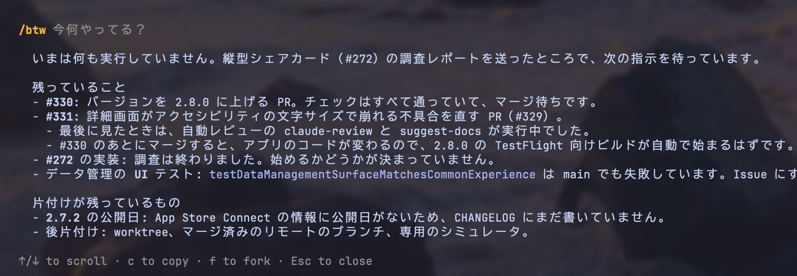
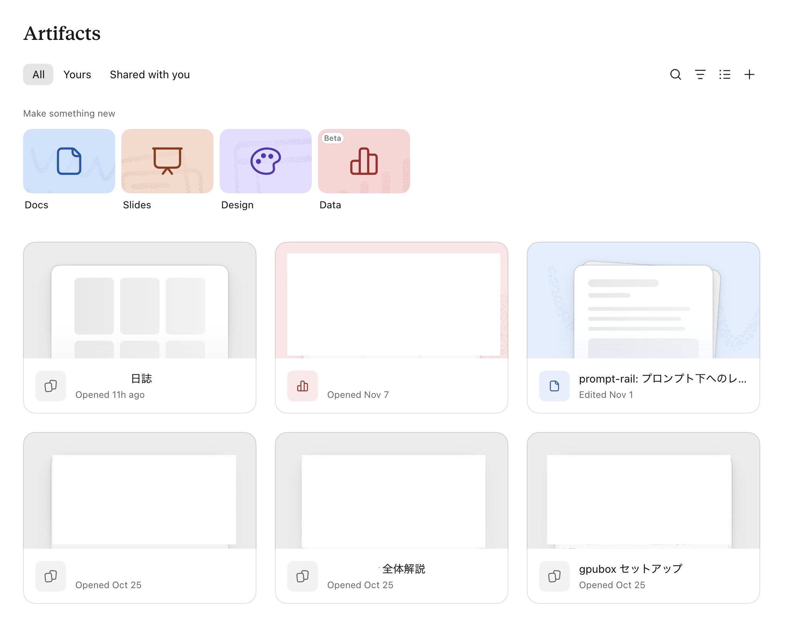
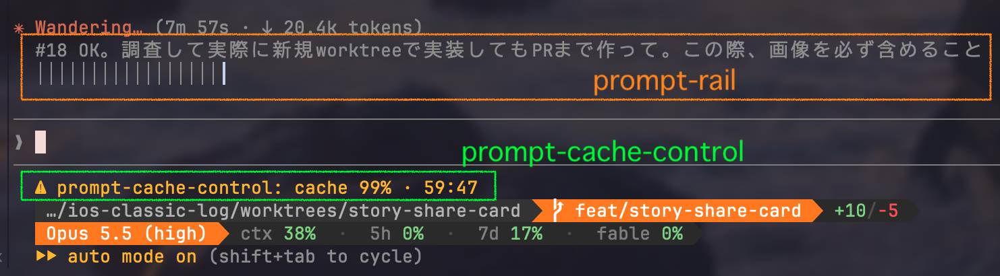
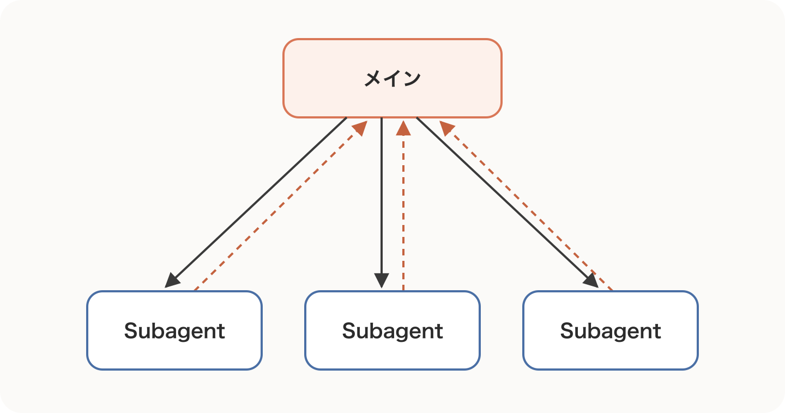
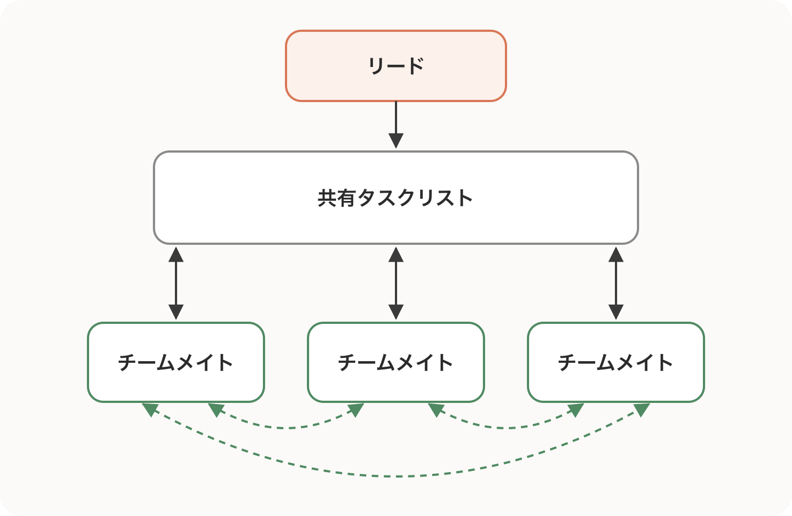
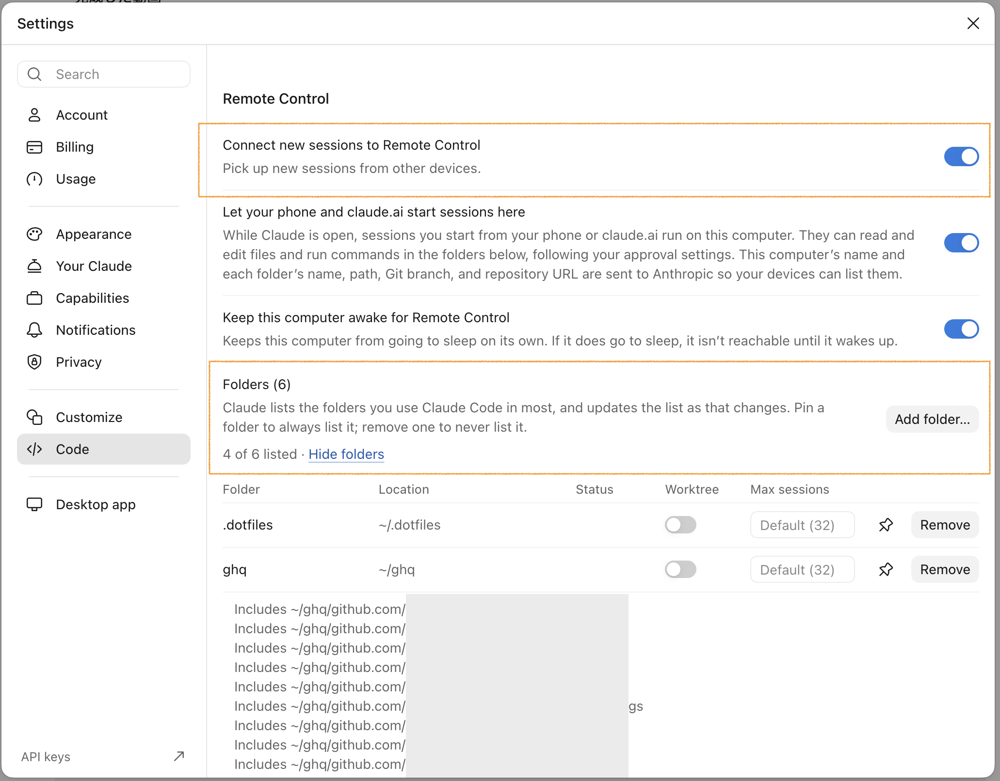
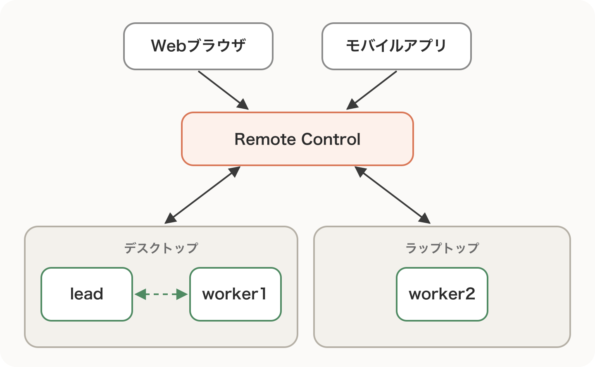
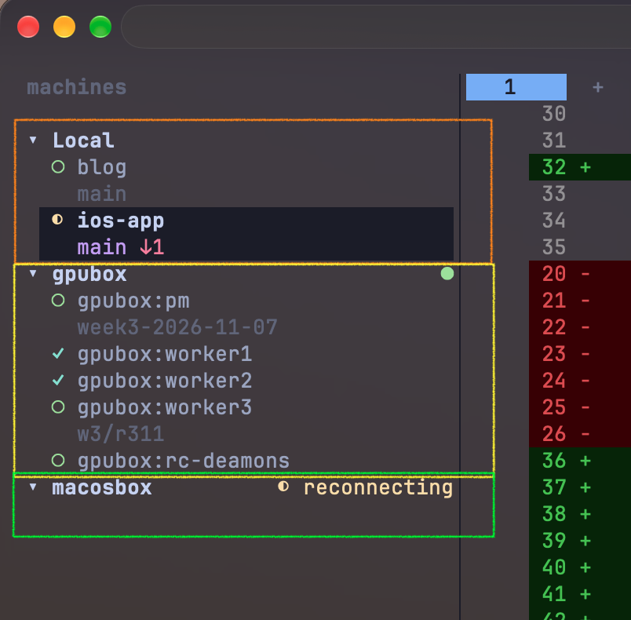

Oikonです。

気がつけば2026年も終わりが見えてきました。今年はありがたいことにClaude Codeの書籍を2冊出版させていただきました。

- [Claude Code実践入門 \[生成AI深掘りガイド\]](https://amzn.asia/d/05iQ8rsa)（SBクリエイティブ）
- [Claude Code実践レシピ集](https://gihyo.jp/book/2026/978-4-297-16027-2)（技術評論社）

新刊のClaude Code実践レシピ集は、個人的に好きなClaude CodeのTipsをベースに、割と好き勝手に書かせていただきました笑。

新しいClaude Code本の発売記念に、この記事では私が最近使っているClaude CodeのTipsを紹介します。

## Claude Codeで最近使っているTips

今回紹介するのは、最近Claude Codeを使っていて特に重宝している次の5つです。

- `/btw`コマンド
- HTMLレポートやArtifacts機能
- Claude Mods
- マルチエージェントパターン
- Remote Control

それぞれ詳しくみていきます。

### `/btw`コマンド

`/btw`は会話履歴に残さずに、今のセッションについて質問できるコマンドです。多分一度は使ったことがあるのではないでしょうか？ちなみにbtwは"by the way"（ところで）という意味です。

```text
〉 /btw 現在の作業中のAについて分かりやすく解説して
```

それまでの会話にある内容（メッセージ、Claudeの返答、ツールの実行結果）のみを使ってClaudeが回答をします。質問と回答はターミナルのオーバーレイに表示され、メインコンテキストには入りません。余談ですが会話のプロンプトキャッシュが残っていればそれが使われるので、コストもほとんどかかりません。

https://code.claude.com/docs/en/interactive-mode#side-questions-with-%2Fbtw

`/btw`コマンドの良いところはいくつかありますが、一つはClaude Codeの作業を中断せずに色々質問をできることです。

Claude Codeは以前に比べると長時間自走できるようになりました。そのため最近では実行状態を見守っていなくてもよくなったのですが、しばらく放置すると現在何をしているかがわかりにくくなりました。

このようなケースで`/btw`コマンドを使って進捗を聞くと、エージェントの作業を中断せずにタスクの進行状況を把握できます。またエージェントのコンテキストを汚さないことも利点の1つです。



個人的によく使う`/btw`コマンドの使い道として、`/compact [description]`を実行するための指示（`[description]`）部分を`/btw`コマンドで生成する方法が挙げられます。

e.g.)

```text
〉 /btw compactionのためのプロンプトを作成して欲しい。ここまでの作業の中でAとCの部分を具体的に...
```

もちろん`/compact`コマンドに自分で指示を書いても良いのですが、長時間駆動していると何が現在の要点なのか把握できていないケースもあるので、セッションの作業内容を把握するついでに`/btw`でプロンプトを作ってもらいます。作ってもらったプロンプトは`c`キーを押すことでコピーできるので、そのままチャット入力欄にコピペも可能です。

Claude Desktopを使っている方であれば、サイドチャットがこれの代わりになります。

### HTMLレポートやArtifacts機能

Claude CodeをはじめとしたAIエージェントは大量の作業をこなしてくれますが、最近はもう人間が全容を把握できる量を超えつつあるように思います。

以前はマークダウン（Markdown）形式で仕様設計やレポートを出力してもらっていましたが、文章量が多くなるにつれて読むのがしんどくなってきました。

そこで最近ではHTML形式をベースにドキュメントを作成してもらい、その中で図や表を用いて情報をエージェントから共有してもらうことが多くなりました。

HTML形式を利用するメリットには以下のような点が挙げられます。

- 情報密度と多様な表現方法で共有できる
- 視認性と読みやすさが調整可能
- 静的サイトで共有しやすい
- インタラクティブUIを組み込める
- データの取り込みが可能

すでにClaudeではClaude Artifacts、ChatGPTではChatGPT Sitesのような公式サービスが提供されています。他にもDevinやCursorでもレポートの執筆依頼を出すとHTML形式で出力し、サービス内のUIでHTMLをレンダリングしてくれるようになっていることから、今後しばらくはエージェントからの情報共有手段はHTMLが主流になると個人的に思います。

Claudeの場合、生成されたArtifactsは[https://claude.ai/code/artifacts](https://claude.ai/code/artifacts)で確認できます。



個人的に最近はサイドプロジェクトでClaude Codeを24/7で実行していることも多いため、Claude Codeに1日2回ほどレポートをClaude Artifactsで追記・更新してもらい、そこで進捗確認をすることが多いです。HTML形式で出力してくれるため、PCデバイスを開かなくてもClaudeモバイルアプリのArtifactsから隙間時間に見ることができます。

### Claude Mods

Claude ModsはClaude Codeの見た目や動作を変えられるプラグインです。CLIのほかにClaude DesktopのCodeタブやVS Code拡張でも動きます。

さらに踏み込むと、ModはJavaScriptかTypeScriptで書いたイベントハンドラ（フック）でできています。ツールの呼び出し、プロンプトの送信、画面の描画といったイベントが起きるとClaude Codeがフックを呼び出します。フックの中ではそのイベントを見るだけにすることも、書き換えることも、代わりに処理することもできます。従来のHooksと違い、ツールの処理そのものを置き換えることもできます。最近Claude CodeがAGENTS.mdに対応した機能も、Claude Modsで実装されています。

https://code.claude.com/docs/en/plugins/mods/overview

Claude Modsは色々カスタマイズできるため、EmacsやVimを弄くり回していたエンジニアは結構好きだと思います。

個人的におすすめのClaude Modsを2つ紹介します。

#### prompt-rail

prompt-railは私が作ったModで、セッションで送ったプロンプトをレールにして表示します。プロンプトとターンの要約が表示され、クリックするとトランスクリプトのその位置まで移動します。長いセッションで前に送ったプロンプトへ戻るときに使うだけでなく、プロンプト入力回数が視覚的に見えるので、どれくらいセッションを使い回しているかざっくり分かります。

prompt-railを表示する場所は次の3つから選べるようにしました。

- horizontal（既定）: プロンプト入力欄の上に棒を並べる
- vertical: トランスクリプトの横のペインに1行ずつ並べる
- below: 入力欄の下のヒント行のさらに下に並べる

`/prompt-rail vertical`のようにコマンドで切り替えられるほか、`/config`の「Rail mode」でも変更できます。以下のコマンドでインストールしてすぐ使えるので、ぜひ使ってみてフィードバックをください。あわよくばGitHub Starボタンも押してくれると嬉しいです。

```bash
claude plugin marketplace add oikon48/prompt-rail
claude plugin install prompt-rail@oikon48
```

https://github.com/oikon48/prompt-rail

#### prompt-cache-control

prompt-cache-controlは、プロンプトキャッシュの状態をプロンプト入力欄の上に表示します。

そもそもClaude Codeはメッセージを送るたびに、それまでの会話をすべてAPIに送り直しています。前のリクエストと先頭から一致する部分はキャッシュから読まれるので、処理が速くなり、料金も安くなります。ただしキャッシュは一定時間使われないと消えます。

プロンプトキャッシュの寿命（Time to Live, TTL）は5分もしくは1時間です。APIキーやusage creditsを使っている場合は5分、Claudeのサブスクリプションでプランの利用枠内なら、メインの会話は1時間になります。キャッシュが切れたあとの最初のリクエストは会話全体を処理し直すので、遅くなり、料金も高くなります。そのためプロンプトキャッシュを意識してClaude Codeを利用すると少しお得に使えたりします。

https://code.claude.com/docs/en/prompt-caching

さて、prompt-cache-controlのClaude Modはリクエストごとに、キャッシュから読んだトークン数（read）、新しく書き込んだ数（wrote）、キャッシュを通らなかった数（new）を数え、キャッシュが切れるまでの残り時間とあわせて帯に表示してくれます。

```text
cache ██████████ 98% read 80k · wrote 1k · new 300 ⏱ 3:41 5m · warm: keep going
cache ░░░░░░░░░░  0% read 0 · wrote 52k · new 300 ⏱ 4:58 5m · cache missed: model changed (…)
cache ██████████ 98% read 150k · wrote 1k · new 300 ⏱ 0:00 5m · expired: the next message rewrites 151k tokens. /compact first, or /clear if the task is done
```

帯の最後にはそのまま続けてよいか、`/compact`や`/clear`をしたほうがよいかが出ます。キャッシュを読めなかったときは、モデルの変更やキャッシュの期限切れといった原因も表示します。`/cache`を実行すると、残り時間のバー、直前のリクエストの内訳、ターンごとの表をペインで確認できます。個人的にチャット入力欄の下に表示されるオプションを使うのが良いと思っています。

以下のコマンドでインストールして使えます。

```bash
npx claude-code-templates@latest --mod observability/prompt-cache-control
```

https://github.com/davila7/claude-code-templates/tree/main/cli-tool/components/mods/observability/prompt-cache-control

ちなみにprompt-railとprompt-cache-control（とstatusline）を組み合わせると以下の画像のようなチャットUIになります。



### マルチエージェントパターン

Claude Codeの機能とは少し変わりますが、マルチエージェントも以前より組みやすくなりました。標準搭載されているSubagentやAgent Teamsを活用すれば、比較的簡単にマルチエージェントオーケストレーションを組むことができます。

エージェント単体ではなく、複数のエージェントを協業させるメリットの1つは並列作業を実行できる点です。1つのエージェントでも複数同時タスクを並行できますが、うまくマルチエージェントを組めば、タスクの質と実行量ともに向上させられると個人的に感じています。

この点についてAnthropicのブログでは、複数のエージェントを協調させる方法をGenerator-Verifier、Orchestrator-Subagent、Agent Teams、Message Bus、Shared Stateの5つのパターンに分けて紹介しています。

https://claude.com/blog/multi-agent-coordination-patterns

マルチエージェントパターンをざっくりと理解しておくことで、複数のタスクを同時並行で実行しやすくなります。ここでは個人的によく使っている（もしくは組み合わせている）マルチエージェントパターンを2つ取り上げます。

#### Orchestrator-Subagentパターン

メインのClaude Codeがまとめ役（オーケストレーター）になり、タスクを切り分けてSubagentに渡すパターンです。図の実線がタスクの依頼、点線が返ってくる結果です。



Subagentはそれぞれ別のコンテキストで作業し、終わったら結果を呼び出し元に返します。

Orchestrator-Subagentパターンは一番オーソドックスなマルチエージェントパターンですが、うまく使えるとタスク実行の時間短縮と網羅性を期待できます。Claude Codeで「サブエージェントで調査をして」など指示すれば自然に使えます。

Orchestratorが複数のSubagentにタスクを依頼し、Subagentが調査途中で読んだファイルや検索結果は要約されてOrchestratorに報告されます。そのため長いセッションでもメインのコンテキストが埋まりにくく、判断に必要な情報だけを手元に残せます。もちろん要約されることはデメリットにもなりえますが、Subagentの参照先のドキュメントリンクなどを後でOrchestratorが読むようにすればそこまで問題になりません。

作業を並列化できることも利用目的の1つです。互いに依存しない作業（Read onlyなど）なら複数のSubagentを同時に動かせるので、複数のライブラリの比較や、ディレクトリごとのコード調査を短い時間で終えられます。

https://code.claude.com/docs/en/sub-agents

#### Agent Teamsパターン

Agent Teamsはリード役のClaude Codeが複数のチームメイトを起動して、チームで作業を進めるパターンです。なおAgent Teamsは2026年11月時点では実験的な機能で、使うには環境変数`CLAUDE_CODE_EXPERIMENTAL_AGENT_TEAMS=1`の設定が必要です。



リード役は作業をタスクに分けて共有タスクリストもしくはドキュメントを作成し、チームメイトはそこからタスクを引き受けて状態を更新していきます。共有される形式はなんでもよく、リポジトリ内のドキュメントやGitHub Issueなどが挙げられます。

Orchestrator-Subagentとの一番の違いは、作業の途中で担当どうしがお互いの進捗を把握し、情報を共有できることです。Subagentは結果を呼び出し元に返すのが基本ですが、Agent Teamsではある担当の発見をほかの担当がすぐに踏まえて作業を進められます。そのため、仮説を出し合って確かめる調査や、実装と検証の作業分担など、担当どうしのやり取りが発生するタスクに向いています。

https://code.claude.com/docs/en/agent-teams

これらのマルチエージェントパターンは1つずつ使用することもできますが、エージェントアーキテクチャの中で組み合わせて使用することも多いです。次に紹介するRemote Controlと組み合わせることで、より使いやすくなります。今回紹介した以外のマルチエージェントパターンも[Claude Code実践レシピ集](https://gihyo.jp/book/2026/978-4-297-16027-2)で解説しているので、ぜひ読んでみてください。

### Remote Control

Remote Controlは自分のマシンで動いているClaude Codeのセッションに、[claude.ai/code](https://claude.ai/code)やClaudeのモバイルアプリからつないで作業を続けられる機能です。最近ではだいぶ取り回しが良くなっています。

Remote ControlはMac Studioやデスクトップマシンのような常に起動できるマシンとの相性が非常によく、うまくループエンジニアリングのようなシステムを構築できれば、1日数回進捗をチェックするだけでプロジェクトを進めることも可能です。

https://code.claude.com/docs/en/remote-control

#### Remote Controlの始め方

Remote Controlは簡単に起動することができます。起動は主に3つの方法があります。

- `claude remote-control`: サーバーモードで起動し、ブラウザやスマホからの接続を待つ。新規セッションも起動できる
- `claude --remote-control`（`--rc`）: 通常の対話セッションをRemote Control付きで起動する
- `/remote-control`（`/rc`）: 実行中のセッションを、それまでの会話ごとRemote Controlにつなぐ

毎回コマンドを打つのが面倒なら、`/config`の「Enable Remote Control for all sessions」を`true`にすると、対話セッションを起動するたびに自動で接続されます。

個人的におすすめの方法は、Claudeデスクトップアプリの設定（Settings > Code）で「Connect new sessions to Remote Control」と「Let your phone and claude.ai start sessions here」をONにし、Webやモバイルアプリからも新規セッションを立ち上げられるようにすることです。新規セッションを立ち上げられるのは「Folders」に並んだフォルダなので、よく使うフォルダはピン留めしておくと常に一覧に残ります。



#### セッション間のメッセージ

Claude Codeはv2.1.224以上で別のセッションにメッセージを送れるようになりました。この機能により個人的にClaude Codeがさらに使いやすくなったと思います。前述のように、常に起動しているデスクトップマシンなどがあれば、そのデスクトップマシン内だけでなく、ブラウザやスマホからRemote Controlでつないだセッションや、別のラップトップのセッションから別のデスクトップマシンのセッションにメッセージを送れます。従来はtmuxなどのマルチプレクサを使ってキー入力自体を送っていたのがより簡単になります。

https://code.claude.com/docs/en/cross-session-messaging

イメージ図は以下の通りです。デスクトップやラップトップで動く別々のセッション（新規セッションも含む）を、Webブラウザやモバイルアプリからまとめて扱えるので、エージェントオーケストレーションの調整がしやすくなりました。



同じマシンのセッションどうし（図の点線）はマシン内のソケットで直接やり取りし、別のマシンのセッションへはRemote Controlの接続を通って届きます。

#### `/rename`でセッションに名前を付ける

セッション間メッセージをより使いやすくするために、`/rename`コマンドもしくは`claude --name`でセッション名をつけるとより使いやすくなります。セッション名はエージェントの役割（Lead、Workerなど）をつけるのがおすすめです。

セッションに名前をつけるメリットとしては、Claude Codeのチャットで`@`メンションを使ってセッションを明示的に指定できることです。たとえば以下のように別のセッションからworker1セッションに指示を飛ばしてもらうことができます。

e.g.)

```text
〉@worker1 にGitHub Issue xxxの調査と実装提案をするようにお願いして。
```

また分かりやすい名前をつけることで、後述するHerdrで複数のセッションを開いた時の視認性を上げられるだけでなく、プロジェクトルールで役割を振っていれば、エージェント自身が自律的に別のセッション（worker1など）に仕事を振ってくれます。

#### Herdrで複数マシンのセッションをまとめる

Remote Controlと`/rename`で名前をつけたマルチセッションを準備した後は、Herdrと組み合わせています。

Herdrはコーディングエージェント向けのターミナルマルチプレクサです。ターミナルをワークスペース、タブ、ペインで整理でき、ペインで動いているエージェントが作業中（working）か、承認や回答を待っている（blocked）か、待機中（idle）かを表示します。Claude CodeのほかにCodexやCursorなどにも対応しています。

Herdrのいいところはtmux同様にSSHでマシンを登録してその中のセッションに簡単に接続できる点です。各マシンでHerdrのサーバーが動いているので、接続が切れても作業は止まらず、1台との接続が切れてもほかのマシンには影響しません。これとRemote Controlを組み合わせれば、マルチセッション・マルチデバイスを1つの画面で管理でき、簡単にマルチエージェントオーケストレーションを構築できます。

実際の使用例として、ローカルとSSH先のマシン（gpubox、macosbox）のセッションが1つのサイドバーに並び、それぞれデバイス間の通信もClaude CodeのRemote Controlで完結します。



各マシンのClaude Codeを動かしてRemote Controlをつないでおくと、外出先からはスマホでそれぞれのセッションの様子を確認できるので、現在はサイドプロジェクトをデスクトップマシンでぐるぐる自律的に回していることが多いです。

https://github.com/herdrdev/herdr

## まとめ

今回は個人的に最近よく使っているClaude CodeのTipsを紹介しました。

以前よりもずっと見張っていなくて良いハーネスを組みやすくなったので、リモートマシンなど常時駆動できる環境の価値が上がった印象です。

他にも色々Tipsはありますが、そのあたりは[Claude Code実践レシピ集](https://gihyo.jp/book/2026/978-4-297-16027-2)の方でも数多く触れているので、ぜひお手に取っていただけると嬉しいです！


https://gihyo.jp/book/2026/978-4-297-16027-2

## Xフォローしてくれると嬉しいです

Xでも情報発信しているので、フォローしていただけると励みになります！

https://x.com/oikon48

## 参考文献

https://code.claude.com/docs/en/interactive-mode#side-questions-with-%2Fbtw

https://code.claude.com/docs/en/plugins/mods/overview

https://code.claude.com/docs/en/prompt-caching

https://claude.com/blog/multi-agent-coordination-patterns

https://code.claude.com/docs/en/sub-agents

https://code.claude.com/docs/en/agent-teams

https://code.claude.com/docs/en/remote-control

https://code.claude.com/docs/en/cross-session-messaging

https://github.com/oikon48/prompt-rail

https://github.com/davila7/claude-code-templates/tree/main/cli-tool/components/mods/observability/prompt-cache-control

https://github.com/herdrdev/herdr

